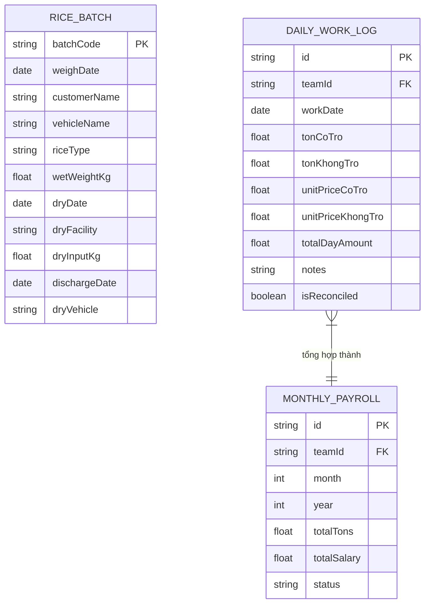

# TÀI LIỆU TOÀN DIỆN HỆ THỐNG: HỢP ĐỒNG & TÍNH LƯƠNG NHÂN CÔNG NÔNG SẢN

> **Mục đích tài liệu:** Lưu giữ đầy đủ toàn bộ bối cảnh dự án, lịch sử trao đổi nghiệp vụ, các quy tắc tính toán thực tế và thiết kế kiến trúc phần mềm giữa người dùng và AI. Mọi phiên làm việc tiếp theo của AI chỉ cần đọc file này là nắm bắt được 100% ngữ cảnh và tiếp tục phát triển không bị gián đoạn.

---

## PHẦN 1: BỐI CẢNH DOANH NGHIỆP & CÁC TÍNH NĂNG ĐÃ HOÀN THÀNH

### 1.1. Thông tin doanh nghiệp
- **Đơn vị chủ quản:** CÔNG TY TNHH XUẤT NHẬP KHẨU CHƠN CHÍNH (Bên Bán).
- **Lĩnh vực hoạt động:** Thu mua, sấy gia công, xay xát và xuất khẩu/thương mại lúa gạo tại Đồng Tháp và các tỉnh Đồng bằng Sông Cửu Long.
- **Trụ sở:** Đường ĐT 846, Ấp 5, Xã Đốc Binh Kiều, Tỉnh Đồng Tháp, Việt Nam.
- **Hệ thống kho/cơ sở:** Gồm nhiều khu/cơ sở (Cơ sở 1, Thuận Thành, Nông sản Thương mại - NSX TM...).

### 1.2. Phân hệ 1: Tạo Hợp Đồng Mua Bán Hàng Hóa (.docx) [ĐÃ HOÀN THÀNH 100%]
- **Công nghệ:** Next.js App Router standalone, TypeScript, Zod, Docxtemplater, PizZip, Tailwind CSS, Vitest.
- **Template hợp đồng:** `templates/hop-dong-mua-ban.docx`.
- **Các tính năng & chuẩn hóa đã hoàn tất:**
  1. **Chuẩn thể thức văn bản hành chính:** Căn lề A4 theo Nghị định 30/2020/NĐ-CP (Top 20mm, Bottom 20mm, Left 30mm, Right 20mm).
  2. **Giãn dòng:** Thân hợp đồng giãn dòng 1.5 (`w:line="360"`), Quốc hiệu/Tiêu ngữ/Căn cứ giữ giãn dòng đơn 1.0 gọn gàng.
  3. **Bảng hàng hóa (Điều 1) thu gọn (Compact):**
     - Đặt chiều cao dòng tối ưu, ô bảng giãn dòng đơn 1.0, không dùng `tblHeader` để tránh lặp tiêu đề.
     - Dòng `TỔNG` gộp 2 cột đầu (`gridSpan="2"`), chữ `TỔNG` in đậm canh giữa, vừa vặn trên Trang 1 không bị đẩy hàng sang Trang 2.
  4. **Số Hợp Đồng & Đại diện:**
     - Dòng `Số: {contract_no}` được in đậm (`w:b`).
     - Tên người đại diện 2 bên tự động chuyển IN HOA và in đậm màu đen.
     - Căn thẳng hàng bên trái 3 dòng Căn cứ pháp lý.
  5. **Hậu tố Bên Mua:** Tên Bên B tự động gắn thêm ` (BÊN MUA).` vào cuối tên công ty khi xuất file Word.
  6. **Đổi vị trí ký tên:** ĐẠI DIỆN BÊN A bên trái, ĐẠI DIỆN BÊN B bên phải.
  7. **Combobox 3 Tài khoản Ngân hàng Bên A:**
     - `MB Bank`: `070977789777` - TMCP Quân Đôi MB bank -CN ĐỒNG THÁP (Mặc định).
     - `Bắc Á Bank`: `660001066668888` - BẮC Á BANK – chi nhánh ĐỒNG THÁP (Chủ TK: CÔNG TY TNHH XNK CHON CHINH).
     - `VietinBank`: `117977789777` - VIETINBANK - CHI NHÁNH TÂY TIỀN GIANG.
  8. **Kiểm thử tự động:** Bộ test Vitest gồm 22 tests pass 100%, TypeScript 0 lỗi.
  9. **Repository GitHub:** `https://github.com/hoaibao3112/TaoHopDongChonChinh.git` (nhánh `main`).

---

## PHẦN 2: PHÂN HỆ MỚI ĐANG THIẾT KẾ: TÍNH LƯƠNG NHÂN CÔNG NÔNG SẢN

### 2.1. Bản chất bài toán thực tế
- Tại các cơ sở sấy & kho lúa, công ty có nhiều đội nhân công bốc xếp, vận chuyển, chụm lò:
  - **Đội nhập:** Bốc lúa tươi từ ghe/tàu lên cân, đưa vào băng tải/tăng bo.
  - **Đội xuất:** Bốc lúa khô sau sấy từ lò xuất ra ghe, hoặc vào bồn trữ.
- Đang bắt đầu triển khai thí điểm trước cho: **ĐỘI CHÚ 6 THANH (Đội Xuất tại Cơ sở 1)**.
- Đội Chú 6 Thanh làm việc liên tục hằng ngày. Cứ 2 - 3 ngày chú sẽ gửi một bản báo cáo công việc (chụp hình trang sổ tay hoặc gửi tin nhắn Zalo).

### 2.2. Nguồn dữ liệu đầu vào

#### Nguồn A: File Excel Tổng Hợp Lúa Tươi Của Công Ty (Master Log)
- **File mẫu thực tế:** `THỊNH_TỔNG SỐ LIỆU NHẬP LÚA TƯƠI 2026.xlsx` (>6.000 dòng, >50 cột từ A đến BB).
- **Các cột dữ liệu gốc liên quan trực tiếp đến tính lương:**
  - `Cột B`: NGÀY CÂN
  - `Cột D`: KHÁCH HÀNG (tên chủ lúa / thương lái)
  - `Cột E`: PHƯƠNG TIỆN (ghe chở lúa tươi)
  - `Cột F`: LOẠI LÚA (OM18, ĐT8, ST25, Nếp CPC, Japonica...)
  - `Cột G`: MÃ LÔ
  - `Cột Y`: NGÀY NHẬP SẤY
  - `Cột Z`: ĐỊA ĐIỂM SẤY (CƠ SỞ SẤY) (VD: `Cơ sở 1`, `NSX TM`...)
  - `Cột AB`: CÂN NHẬP SẤY (KG) (Sản lượng lúa thực tế vào lò)
  - `Cột AE`: NGÀY XUỐNG LÚA KHÔ (NHẬN XUẤT TRẢ)
  - `Cột AG`: PHƯƠNG TIỆN CHỞ LÚA KHÔ (TĂNG BO SAU SẤY) (VD: `VÔ BỒN`, ghe xuất...)
- **Nguyên tắc an toàn dữ liệu:**
  - Phần mềm **nhận trực tiếp File Excel Master** (không cần người dùng cắt file phụ).
  - Phần mềm chỉ map đúng các cột nghiệp vụ cần dùng thông qua tên tiêu đề cột.
  - Tự động bỏ qua các cột tài chính nhạy cảm nội bộ (Giá mua lúa, tiền cọc, ngân hàng thanh toán...).

#### Nguồn B: Sổ Tay Báo Công Nhật Của Đội Trưởng (Chú 6 Thanh)
- **Hình thức thực tế:** Chú ghi chép tay theo từng ngày (Hình ảnh mẫu ngày `30/9`).
- **Nội dung chú ghi:**
  - Chi tiết các mẻ sấy ghép lại thành từng lô (Ví dụ: `{26, 33, 33} = 92.015 kg` khách Hải Hân; `{27, 25} = 52.102 kg` Hải Hân Luyện; `72.393 kg` Quân Vy; `72.300 kg` Út NĐ; `86.725 kg` Hải Hân Luyện).
  - Tên ghe bốc lúa khô: `NN25`, `NN11`, `NN06`, `NN08`.
  - **TỔNG KẾT CHÂN TRANG (Mấu chốt chốt tiền của chú):**
    ```text
    Có trở xuất : 168 x 20 = 3360  (168 tấn x 20.000đ = 3.360.000đ)
    Xuất 0 trở  : 253 x 16 = 4048  (253 tấn x 16.000đ = 4.048.000đ)
    --------------------------------------------------------------
    Tổng cộng ngày 30/9    : 7.408 (7.408.000đ)
    ```

### 2.3. Các Quy Tắc Nghiệp Vụ Cốt Lõi (Core Business Rules)

#### Quy tắc 1: Làm tròn số tấn (Rounding Rule)
- Đơn vị tính: `Số tấn = Cân nhập sấy (kg) / 1000`.
- **Quy tắc công ty:**
  - Nếu phần lẻ $\ge 0.333$ tấn ($\ge 333$ kg) $\rightarrow$ **Làm tròn lên 1 tấn** (VD: $50.3332 \rightarrow 51$ tấn; $112.670 \rightarrow 113$ tấn).
  - Nếu phần lẻ $< 0.333$ tấn ($< 333$ kg) $\rightarrow$ **Làm tròn xuống** (VD: $75.125 \rightarrow 75$ tấn; $110.278 \rightarrow 110$ tấn).

#### Quy tắc 2: Cơ cấu các khoản lương Đội Xuất
Tùy vào từng đội và thời điểm, lương đội xuất bao gồm các công đoạn:
1. **Xuất có trở:** Tấn $\times$ Đơn giá (VD: 20.000đ/tấn hoặc 17.000đ/tấn).
2. **Xuất không trở:** Tấn $\times$ Đơn giá (VD: 16.000đ/tấn hoặc 11.000đ/tấn).
3. **Chụm lò:** Tấn $\times$ Đơn giá phân loại lúa:
   - Lúa thường (OM18, ST25, Japonica...): 8.000đ/tấn.
   - Nếp (Nếp CPC...): 11.000đ/tấn.
4. **Vô bồn (nếu có):** Tấn $\times$ Đơn giá 3.000đ/tấn.
*(Đối với Đội Chú 6 Thanh: Chú gửi tổng kết theo 2 mục: **Xuất có trở** và **Xuất không trở**).*

#### Quy tắc 3: Thuật toán Tự động Ghép Mẻ Thông Minh (Smart Auto-Match)
- **Vấn đề:** Chú Thanh báo con số gộp (VD: 168 tấn có trở, 253 tấn không trở), nhưng 168 tấn này do nhiều mẻ sấy cộng lại (VD: $68 + 30 + 70 = 168$).
- **Giải pháp:**
  - Khi nạp dữ liệu ngày hôm đó từ file Excel, hệ thống có danh sách các mẻ sấy thực tế.
  - Khi người dùng nhập `168 tấn có trở` và `253 tấn không trở`, hệ thống chạy thuật toán giải bài toán tổng con (Subset Sum Match) để tự động tìm các lô có tổng bằng 168 tấn và gán nhãn `Có trở`, các lô còn lại gán nhãn `Không trở`.
  - Hiển thị bảng kết quả xem trước cho người dùng bấm xác nhận.

#### Quy tắc 4: Màn hình Đối Soát Nhanh (Reconciliation Check)
- Người dùng chỉ cần nhập số tổng ngày từ sổ của chú:
  - Ô 1: Số tấn xuất có trở (VD: `168`).
  - Ô 2: Số tấn xuất không trở (VD: `253`).
- Hệ thống tự nhân đơn giá ra tổng tiền (`7.408.000đ`).
- Nếu số tiền trùng khớp với con số chú ghi ở chân trang $\rightarrow$ Đèn **Xanh Lá (Khớp 100%)** $\rightarrow$ Bấm 1 nút Lưu dữ liệu.

---

## PHẦN 3: ĐỊNH HƯỚNG KIẾN TRÚC & CÁC BƯỚC TRIỂN KHAI TIẾP THEO

### 3.1. Mô hình Dữ liệu (Data Model dự kiến)


### 3.2. Lộ trình triển khai (Next Steps)
1. **Giai đoạn 1 (Thuật toán & Thử nghiệm Parser):**
   - Viết parser đọc tự động file Excel Master `THỊNH_TỔNG SỐ LIỆU NHẬP LÚA TƯƠI 2026.xlsx`.
   - Cài đặt hàm làm tròn chuẩn: $\ge 0.333 \rightarrow$ làm tròn lên.
   - Cài đặt thuật toán Subset Sum Auto-Match để tự khớp các mẻ lúa ra 168 tấn và 253 tấn.
2. **Giai đoạn 2 (Giao diện Nhập Nhanh & Đối Soát Đội Chú 6 Thanh):**
   - Màn hình nhập công nhật nhanh (chỉ cần nhập ngày, số tấn có trở, số tấn không trở).
   - Bảng xem trước danh sách chi tiết mẻ lúa.
   - Hộp so khớp tiền tức thì so với sổ tay chú.
3. **Giai đoạn 3 (Bảng Kê & Xuất Excel Lương Cuối Tháng):**
   - Tự động gom 30 ngày thành Bảng kê tính lương tháng chuẩn y hệt hình mẫu `BẢNG KÊ TÍNH LƯƠNG THÁNG 10/2026 ĐỘI NAM-XUẤT-NSX TM`.
   - Xuất file Excel / PDF báo cáo lương có đầy đủ chữ ký cho đội trưởng.
